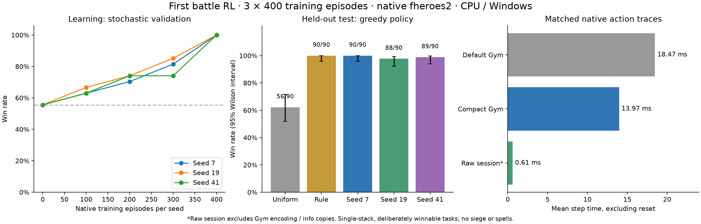

# Első tényleges csata-RL tanítás

A [battle_rl.py](../python/examples/battle_rl.py) valódi, natív csatákból tanít és értékel ki egy kisméretű neurális policy-t.
A meglévő `HeroesEnv.reset/step` API-t használja; a C++ motorhoz és a játékszabályokhoz ez a kísérlet nem nyúl.
A cél az első tanulási jel, a modell mentés/visszatöltés és a teljes Python–motor lépésköltség ellenőrzése.

## Tényleges Windows-eredmény, 2026-10-31

**A tanulás kimutatható volt mindhárom futásban.** 3 × 400 tanítóepizód, összesen 5024 tanítási Gym-lépés;
a tanítások validációval együtt 88,4 / 93,1 / 88,7 másodpercet igényeltek. A teljes kísérlet
az összes referenciával, végső kiértékeléssel és benchmarkkal **377,5 másodperc** volt, CPU-n.

| Vezérlő | Győzelem / 90 külön tesztcsata | Vereség | Megszakítás |
|---|---:|---:|---:|
| Egyenletes maszkos random; a háló induló eloszlása | 56 / 90 (**62,2%**) | 33 | 1 |
| Szabályalapú referencia | 90 / 90 (**100%**) | 0 | 0 |
| Tanított, seed 7, greedy | 90 / 90 (**100%**) | 0 | 0 |
| Tanított, seed 19, greedy | 88 / 90 (**97,8%**) | 0 | 2 |
| Tanított, seed 41, greedy | 89 / 90 (**98,9%**) | 0 | 1 |
| Tanított, mindhárom seed külön-külön, mintavételezve | egyenként 88 / 90 (**97,8%**) | 2 | 0 |

Mindhárom modell 400. epizód utáni checkpointja nyert a saját validációján. A kiadott seed 7 modell
kiválasztása kizárólag validáció alapján történt, a végső teszt előtt.
A randomhoz mért páros javulása **+37,8 százalékpont**, 95%-os bootstrap-intervalluma **+27,8…+47,8 százalékpont**.
A 90/90 győzelem Wilson-intervalluma 95,9–100%; ez nem garantált 100%-os általános sikerarány.
Az új desert/swamp/lava terepek 27 próbáján 27/27 győzelem született (random 14/27, szabály 27/27).
A visszatöltött JSON-modell külön újrafuttatva mind a 90 esetben azonos natív akciósort és eredményt adott.



Azonos, 27 csatából és 58 natív Python-döntésből álló benchmark; Release build, render nélkül:

| Mód | Átlagos step | Step p95 | Step/s, reset nélkül | Reset átlaga | Teljes lépés/s resetekkel |
|---|---:|---:|---:|---:|---:|
| Alap Gym | 18,47 ms | 21,18 ms | 54,1 | 64,76 ms | 20,3 |
| Csatához méretezett Gym | 13,97 ms | 15,34 ms | 71,6 | 57,60 ms | 24,3 |
| Közvetlen session, kisebb szolgáltatási szerződés | 0,61 ms | 0,77 ms | 1641,6 | 44,49 ms | 39,2 |

Az alap Gym-megfigyelés 8 751 734 byte, a csatához méretezett 285 928 byte.
A kiválasztott modell jellemzőképzése és inferenciája átlagosan 0,30 ms/döntés volt a külön teszten.
A raw érték nem a teljes Gym-adapter sebessége: nem adja vissza annak numerikus megfigyelését és másolt `info` adatait.
A benchmark mindhárom módnál ellenőrizte az azonos natív akciósort és eredményt.
A rövid profilban a 18 `_info` hívás kumulatív költsége 0,223 s volt, a 36 numerikus kódolásé 0,044 s;
a másolási költség ezért indokolt optimalizálási cél. A reset új motorfolyamatot indít.
A sorrendben mért módok egyetlen rövid helyi benchmarkot jelentenek, nem több ismétlésből becsült sebességintervallumot.

Megőrzött bizonyítékok:

- [Teljes jelentés és forrás/bináris/adat SHA256-ok](python_env/rl-first-battle.windows.2026-10-31.report.json).
- [Tanítás előtt rögzített terv és esetlista](python_env/rl-first-battle.windows.2026-10-31.plan.json).
- [Kiadott modell](python_env/rl-first-battle.windows.2026-10-31.model.json),
  [seed 19](python_env/rl-first-battle.windows.2026-10-31.model-seed-19.json),
  [seed 41](python_env/rl-first-battle.windows.2026-10-31.model-seed-41.json).
- [Mind a nyolc tesztkiértékelés esetenkénti eredménye és natív akciósora](python_env/rl-first-battle.windows.2026-10-31.evaluation.json).

A jelentésben a szülőcommit `d802e23`, a munkafa még módosított volt: az új példa és teszt ekkor nem volt commitolva.
Ezek pontos fájlhashét külön rögzíti a jelentés; a natív bináris és a Python-csomag a szülőcommit változatlan kódja.
Az eredmények a fenti egyszerű curriculumra vonatkoznak. A referencia elérése valódi tanulási jel,
de nem erősebb általános csata-AI bizonyítéka. Linux/macOS futás és mobil build ebben a kísérletben nem történt.

## Futtatás

Meglévő opcionális desktop env builddel, játékadatokkal, a repository gyökeréből:

```powershell
uv run --project python --cache-dir .tools/uv-cache --extra gym --locked python python/examples/battle_rl.py --episodes 400 --seeds 7 19 41 --checkpoint-every 100 --output build/python-env-first-rl/final
```

A futás CPU-t használ, külső tanított modell vagy Torch/CUDA-függőség nélkül.
A base Python-csomag és a normál/mobil játék függőségei változatlanok; csak a meglévő opcionális `gym` extra kell.
A `FHEROES2_DATA` továbbra is a játékadatok helyét adhatja meg.

Rövid, kizárólag train/validation próbához:

```powershell
uv run --project python --cache-dir .tools/uv-cache --extra gym python python/examples/battle_rl.py --pilot --episodes 80 --seeds 7 --checkpoint-every 40 --output build/python-env-first-rl/pilot
```

A `--pilot` nem futtatja a végső tesztkészletet. A kísérleti terv a tanítás kezdete előtt `plan.json` fájlba kerül.

## A tanulási feladat

Három egyszerű, szándékosan megnyerhető felállás, három terepen (`grass`, `snow`, `water`):

| Család | Python-oldal | Natív AI-oldal |
|---|---|---|
| Lövész | 10/12/14 Ranger | 45/60/75 Peasant |
| Közelharc | 6/7/8 Swordsman | 24/30/36 Goblin |
| Repülő | 7/8/9 Griffin | 20/24/28 Skeleton |

Mindkét sereg egy csapatból áll. A Python-oldalnak alapértékű hőse van, a natív ellenfélnek nincs hőse,
így az ellenfél nem oldhatja meg automatikus meneküléssel a csatát. Nincs varázslás vagy tárgyhasználat a tanítási feladatban.
A legális mozgás, támadás, lövés, várakozás és menekülés a motor listájából jön; a policy nem kap előre kiválasztott jó akciót.

A jutalom a módosítatlan Gym-jutalom: győzelem +1, vereség −1, döntetlen/megszakítás 0.
Nincs sebzésből vagy távolságból számolt jutalom és nincs imitációs tanítóadat.
A feladat véges horizontú: legfeljebb 10 natív csatakör, illetve 80 Python-lépés; a megszakításokat külön jelentjük.

Ez egy szűk, taktikai tanulási feladat. Az egyszerű szabályalapú vezérlő itt erős referencia;
a kísérletből nem következik, hogy a modell tetszőleges csatát, ostromot vagy teljes kalandjátékot megtanult.

## Modell és algoritmus

Maszkos REINFORCE, epizódonkénti Monte Carlo-visszatéréssel és korábbi batchből számolt, állapottól független EMA-bázissal.
A módszer alapja [Sutton–Barto 13.3–13.4. fejezete](https://www.incompleteideas.net/book/bookdraft2018mar21.pdf).
A NumPy-megvalósítás a legális akciókhoz közös pontozóhálózatot használ:

- 24, kizárólag a nyilvános numerikus Gym-megfigyelésből képzett jellemző.
- 16 `tanh` rejtett egység, összesen **416 paraméter**.
- Softmax csak a legális jelölteken; a kitöltő/padding akciók soha nem vehetők ki.
- A kezdeti kimeneti súly nulla, ezért az induló policy pontosan egyenletes a legális jelölteken.
- 8 epizód/batch, egyszeri on-policy frissítés, `gamma=1`, tanulási ráta 0,01, entrópia-együttható 0,01.
- Adam frissítés és 5-ös gradiensnorma-korlát.

A jellemzők között akciótípus, létszám/HP, lövés, sebesség, szélesség/repülés, célpontadat és geometriai távolság szerepel.
A távolságot jellemzőként adjuk, az irány és a cselekvés súlyát a hálózat tanulja.
A modell nem kap seedet, jövőbeli jutalmat, győztes-címkét, szabályalapú akciójelzést vagy előre szimulált akcióeredményt.
Ez kézzel előkészített numerikus bemenet; nem képből vagy az egész nyers világállapotból tanuló hálózat.

A kézi gradiens véges differenciával ellenőrzött. A teszt pozitív jutalom után valódi valószínűségváltozást,
a súlyok változását és a JSON-mentés pontos visszatöltését is vizsgálja.
A teljes meglévő és új Python/Gym tesztcsomag **223/223 sikeres** volt (147,0 s);
ebből öt új teszt a gradienst, tanulást, seedhalmazokat, visszatöltést és az azonos benchmark-akciósorokat ellenőrzi.
A mentett modell natív RGB/PPM demója is lefutott. A C++-forrás, a natív executable és a csomagfüggőségek nem változtak.

## Train, validation és teszt

A teljes futás három külön tanítás: **7, 19 és 41** tanulási seed, egyenként 400 epizód.
A natív csataseedek eltérnek a modell tanulási seedjétől.

| Halmaz | Natív seedek / elemszám |
|---|---|
| Train | Véletlen mintavétel a 0–4095 tartományból; család, terep és erősségváltozat is mintavételezett |
| Validation | 27 előre rögzített eset, 10000-től; csak checkpointválasztáshoz |
| Teszt | 90 előre rögzített eset, 20000-től; tanítás és checkpointválasztás után |
| Új terepek | 27 eset desert/swamp/lava terepen, 30000-től; külön általánosítási próba |

A seedhalmazok diszjunktak, ezt a futás és a regressziós teszt is ellenőrzi.
Száz epizódonként a mintavételezett policy validation-eredménye választ checkpointot;
azonos pontszámnál a korábbi checkpoint marad. A három tanítás közül is kizárólag validation alapján választjuk a kiadott modellt.
A végső teszteredmény nem befolyásolja a súlyokat vagy a modellválasztást.

Mindhárom kiválasztott modellnél külön mérjük a determinisztikus `argmax` és a valószínűségi mintavétel eredményét.
Az összehasonlítás egyenletes, **szintén maszkot használó** véletlen policy-val és egyszerű shoot/attack/közeledés szabállyal történik.
Azonos eseteket és seedeket hasonlítunk. A győzelmi arányhoz Wilson-intervallum,
a kiválasztott modell–random különbséghez 5000 mintás páros bootstrap tartozik.
A három tanulási seed eredményét külön közöljük, nem kezeljük a közös teszteseteket háromszor annyi független mintaként.

Az előre rögzített `learning_detected` feltétel: legalább 15 százalékpont javulás a randomhoz képest,
pozitív alsó bootstrap-határ és legalább két tanulási seed javulása.
Ha ez nem teljesül, a jelentés nem állít sikeres tanulást.

## Sebességmérés

A tanítás nem renderel. Külön mérjük a resetet, az env-lépést és a jellemzőképzés/inferencia idejét.
A `step` ideje a teljes Gym API-hívás: Python-parancs, az addig esedékes natív AI-lépések,
állapotlekérés, numerikus kódolás és visszaadott `info`/megfigyelés-másolat.
Egy ilyen lépés nem feltétlenül egy natív egységkör vagy csatakör.

A benchmark három módot használ, ugyanazokon a csatákon és azonos natív akciósorral:

1. Alapértelmezett `HeroesEnv`, teljes alapkapacitásokkal.
2. A csatához méretezett, meglévő konstruktorparaméterekkel beállított `HeroesEnv`.
3. Közvetlen `HeroesSession`, Gym-kódolás és `info`-másolás nélkül.

A tömör profil: térképméret 2, 128 hős, 1 vár, 8 csataegység, 256 akcióhely, 1 byte-os szövegbufferek.
Nincs jelöltlevágás: ha a felállás nem fér bele, a szokásos explicit profilhiba érkezik.
A benchmark ellenőrzi az alap/tömör/raw akciósor és natív eredmény egyezését.
Külön közöljük a lépés/s értéket és a resetet is tartalmazó teljes sebességet.
A raw szám kisebb szerződés költsége, nem ugyanaz a szolgáltatás olcsóbban.

Rövid `cProfile` bontás segít azonosítani az állapotkérés, kódolás és másolás idejét.
Az egymásba ágyazott függvények kumulatív ideje nem adható össze.
A mérések helyi CPU-mérések; párhuzamos vektoros tanítást vagy hosszú RL-terhelést ez még nem helyettesít.

## Mentett modell használata

```powershell
uv run --project python --cache-dir .tools/uv-cache --extra gym --locked python python/examples/battle_rl.py --evaluate-only docs/python_env/rl-first-battle.windows.2026-10-31.model.json --output build/python-env-first-rl/recheck
uv run --project python --cache-dir .tools/uv-cache --extra gym --locked python python/examples/battle_rl.py --demo docs/python_env/rl-first-battle.windows.2026-10-31.model.json --output build/python-env-first-rl/demo
```

A modell JSON, nincs pickle vagy tetszőleges kódot betöltő formátum. A séma és a súlyok mérete/értékei ellenőrzöttek.
A checkpointok inferenciasúlyokat tartalmaznak; a pontos tanítás újraindítása a rögzített parancsból és seedekből történik.
A demó natív RGB-képeket ír PPM-be. A tanítás maga nem igényel grafikus ablakot.

## Fennmaradó irányok

1. Nehezebb, többcsapatos és varázslatos tanítás, ostromok és erősebb általánosítási tesztkészlet.
2. Nagyobb RL-profilozás, a mért Gym/RPC/másolási költség optimalizálása és párhuzamos adatgyűjtés.
3. Linux/macOS és mobil SDK-build/futásellenőrzés.
4. Igény szerint láthatóságra szűrt megfigyelés és több agentes Gym/self-play wrapper.
